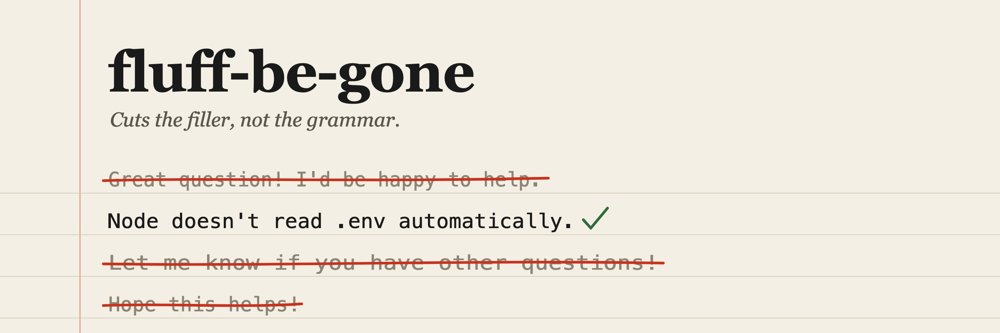

<p align="center">
  
</p>

<p align="center">
  <a href="LICENSE"></a>
  
  
  
</p>

<p align="center">
  <a href="README.md">English</a> · <b>Français</b>
</p>

---

Tu poses une question. Ton agent répond *« Excellente question ! Je serais ravi de t'aider »*, reformule ta demande, annonce ce qu'il va faire, le fait, résume le tout, puis te demande si tu as d'autres questions.

**fluff-be-gone** garde la réponse et jette le reste.

## Pourquoi pas le style « homme des cavernes » ?

Les skills télégraphiques économisent des tokens en supprimant les articles et en écrivant par fragments. Ça marche, mais tu te retrouves à déchiffrer `Inline obj prop → new ref → re-render` à 2 h du matin.

fluff-be-gone coupe les **phrases inutiles entières**, pas la grammaire. Les réponses sont courtes et restent faciles à lire.

|  | Agent par défaut | Style caveman | **fluff-be-gone** |
|---|---|---|---|
| Formules d'intro et de fin | oui | non | **non** |
| Phrases complètes | oui | non | **oui** |
| La réponse arrive en premier | parfois | oui | **oui** |
| Lisible par un débutant | oui | pas vraiment | **oui** |
| Mots dans l'exemple ci-dessous | 64 | ~12 | **25** |

## Avant / après

<table>
<tr><th>Avant</th><th>Après (<code>full</code>)</th></tr>
<tr>
<td>

Absolument ! Je comprends tout à fait ton besoin. En fait, pour renommer une branche Git, il suffit tout simplement d'utiliser la commande suivante. N'hésite pas si tu as d'autres questions !

</td>
<td>

```bash
git branch -m ancien-nom nouveau-nom
```

Si elle est déjà poussée : `git push origin -u nouveau-nom` puis `git push origin --delete ancien-nom`.

</td>
</tr>
</table>

<details>
<summary><b>La seule règle derrière tout ça</b></summary>

<br>

Pour chaque phrase, l'agent se demande :

> *Si je la supprime, le lecteur perd-il un fait, une décision, un avertissement ou une prochaine étape ?*

Si la réponse est non, la phrase part.

</details>

## Installation

**Claude Code** (en plugin) :

```text
/plugin marketplace add pixel-noir/fluff-be-gone
/plugin install fluff-be-gone@fluff-be-gone
```

**Tout agent qui lit les `SKILL.md`** :

```bash
git clone https://github.com/pixel-noir/fluff-be-gone.git
cp -r fluff-be-gone/skills/fluff-be-gone ~/.claude/skills/
```

## Utilisation

Dis `sans blabla`, `droit au but`, `va à l'essentiel` ou `fluff-be-gone`. Les déclencheurs anglais (`no fluff`, `be concise`) marchent aussi. L'agent répond toujours dans ta langue.

Le mode reste actif toute la session. Pour l'arrêter, dis `mode normal`.

| Niveau | Ce qu'il fait |
|---|---|
| `lite` | Supprime les formules d'intro, de fin, les compliments et les offres creuses. Garde les explications. |
| `full` | **Par défaut.** Supprime tout le remplissage, donne la réponse en premier, garde une ligne de *pourquoi*. |
| `ultra` | `full`, sans le *pourquoi* sauf si tu le demandes. Du code, des commandes et des tableaux plutôt que de la prose. |

Change de niveau avec `fluff-be-gone lite`, `fluff-be-gone full` ou `fluff-be-gone ultra`.

> [!IMPORTANT]
> **Certains contenus ne sont jamais coupés, quel que soit le niveau :**
> - les avertissements de sécurité et les risques de perte de données
> - les confirmations avant une action irréversible
> - le code, les commandes, les chemins, les messages d'erreur et les versions, tels quels
> - ce qui n'a pas été fait ou pas vérifié
> - les étapes numérotées, dans l'ordre
> - les questions de clarification
> - une explication complète quand tu es perdu ou que tu demandes *pourquoi*

## Crédits

Inspiré de [no-fluff](https://github.com/yeaight7/agent-powerups/tree/main/skills/no-fluff) du repo agent-powerups, qui choisit le style télégraphique.

## Licence

[MIT](LICENSE)
