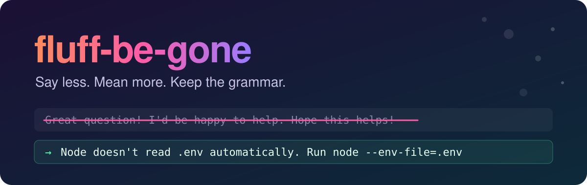

<p align="center">
  
</p>

<p align="center">
  <a href="LICENSE"></a>
  
  
  
</p>

<p align="center">
  <b>English</b> · <a href="README.fr.md">Français</a>
</p>

---

You ask a question. Your agent answers *"Great question! I'd be happy to help"*, restates what you said, explains what it's about to do, does it, sums it all up, then asks if you have any other questions.

**fluff-be-gone** keeps the answer and drops the rest. 🪶

## 🤔 Why not just go caveman?

Telegraphic skills save tokens by dropping articles and writing in fragments. That works, but you end up decoding `Inline obj prop → new ref → re-render` at 2 a.m.

fluff-be-gone cuts **whole useless sentences** instead of grammar. Replies get short and stay easy to read.

|  | 😴 Default agent | 🦴 Caveman style | 🪶 **fluff-be-gone** |
|---|---|---|---|
| Opening filler & sign-off | yes | no | **no** |
| Full sentences | yes | no | **yes** |
| Answer comes first | sometimes | yes | **yes** |
| Easy for a newcomer to read | yes | not really | **yes** |
| Words in the example below | 64 | ~12 | **25** |

## ✂️ Before / after

<table>
<tr><th>😴 Before</th><th>🪶 After (<code>full</code>)</th></tr>
<tr>
<td>

Great question! I'd be happy to help you with that. So, basically, the issue you're seeing is most likely caused by the fact that your environment variable isn't being loaded. Let me explain: Node doesn't read `.env` files automatically. To fix this, you can simply install dotenv. Hope this helps, and let me know if you have any other questions!

</td>
<td>

Node doesn't read `.env` automatically, so `API_KEY` is undefined. Load it at startup:

```js
import 'dotenv/config';
```

Or run `node --env-file=.env app.js` (Node 20.6+).

</td>
</tr>
</table>

<details>
<summary><b>The one rule behind it</b></summary>

<br>

For every sentence, the agent asks itself:

> *If I delete this, does the reader lose a fact, a decision, a warning or a next step?*

If the answer is no, the sentence goes.

</details>

## 📦 Install

**Claude Code** (as a plugin):

```text
/plugin marketplace add Pixel-Noir/fluff-be-gone
/plugin install fluff-be-gone@fluff-be-gone
```

**Any agent that reads `SKILL.md`**:

```bash
git clone https://github.com/Pixel-Noir/fluff-be-gone.git
cp -r fluff-be-gone/skills/fluff-be-gone ~/.claude/skills/
```

## 🎚️ Usage

Say `fluff-be-gone`, `no fluff`, `be concise` or `stop the fluff`. In French, `sans blabla`, `droit au but` or `va à l'essentiel` work too.

It stays on for the whole session. To turn it off, say `fluff back` or `normal mode`.

| Level | | What it does |
|---|---|---|
| `lite` | 🌤️ | Drops the openers, closers, flattery and empty offers. Keeps the explanations. |
| `full` | ☀️ | **Default.** Drops all filler, puts the answer first, keeps a one-line *why*. |
| `ultra` | 🔥 | `full`, minus the *why* unless you ask. Code, commands and tables over prose. |

Switch levels with `fluff-be-gone lite`, `fluff-be-gone full` or `fluff-be-gone ultra`.

> [!IMPORTANT]
> **Some content is never cut, whatever the level:**
> - security warnings and data-loss risks
> - confirmations before irreversible actions
> - code, commands, paths, error messages and versions, exactly as written
> - anything that was not done or not verified
> - numbered steps, in order
> - clarifying questions
> - a full explanation when you're lost or ask *why*

## 🙏 Credits

Inspired by [no-fluff](https://github.com/yeaight7/agent-powerups/tree/main/skills/no-fluff) from agent-powerups, which goes the telegraphic way.

## 📄 License

[MIT](LICENSE)
